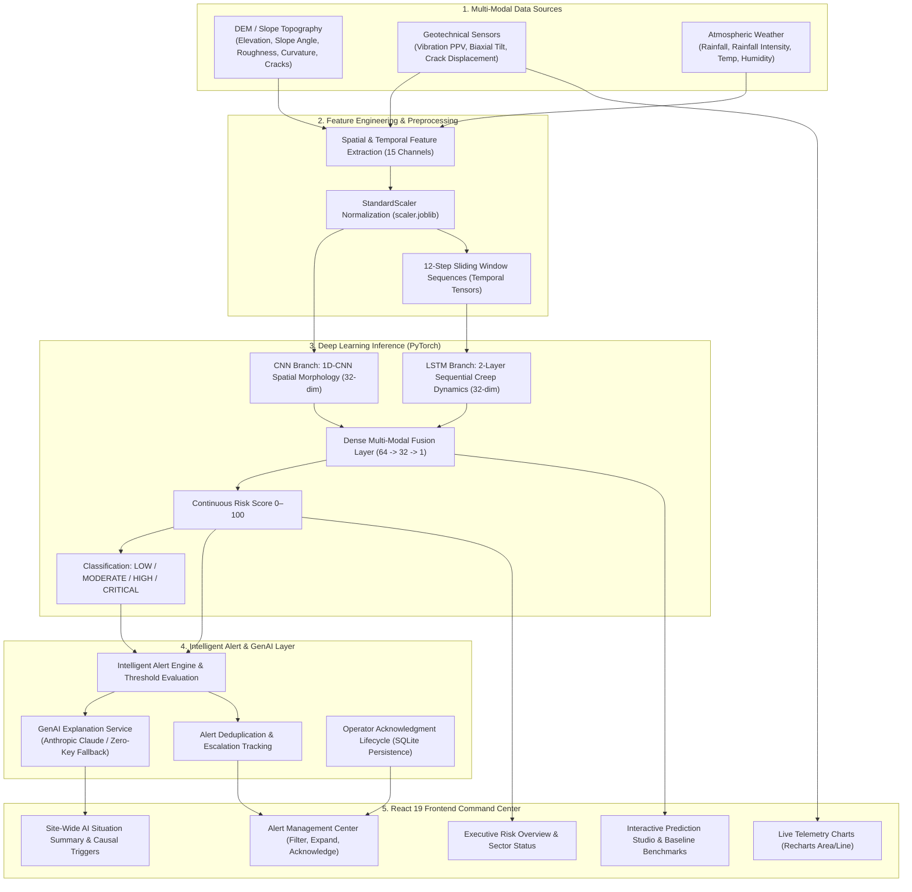
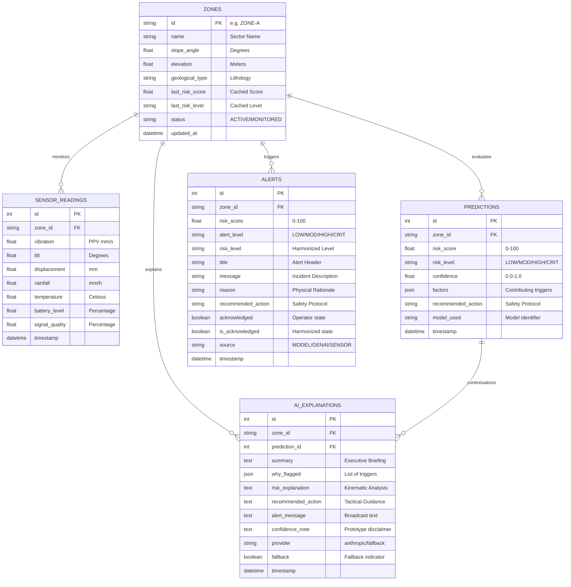

# System Architecture & Technical Design

## 1. Executive Summary

**RockfallAI** is an AI-powered multi-modal rockfall risk prediction and early warning software prototype. The system provides real-time situational awareness, quantitative risk forecasting, autonomous incident explanations, and intelligent alert lifecycle management for open-pit mining highwalls and rock slopes.

The architecture is divided into three core tiers:
1. **Multi-Modal Predictive Engine (FastAPI + PyTorch + Scikit-Learn):** Fuses spatial terrain morphology and temporal geotechnical telemetry to compute a continuous 0–100 risk score and 4-tier hazard classification.
2. **Explainable GenAI & Intelligent Alert Subsystem:** Provides natural language causal reasoning via the Anthropic Claude API (with a deterministic zero-key fallback engine) and an intelligent alert lifecycle manager with deduplication, escalation, recovery tracking, and supervisor acknowledgment.
3. **Command & Control Presentation Tier (React 19 + Recharts):** An industrial-grade dark engineering dashboard providing sector heatmaps, real-time telemetry plots, interactive prediction studio, and alert management.

---

## 2. Architecture Diagram



---

## 3. Separation of Concerns & Safety Design

A fundamental architectural principle of RockfallAI is the **strict separation of responsibilities**:

```
+-------------------------------------------------------------+
|                     QUANTITATIVE ENGINE                     |
|  PyTorch CNN-LSTM Hybrid Model + Geotechnical Physics Rules |
|  - Sole authority on Risk Score (0.0 to 100.0)              |
|  - Sole authority on Risk Level (LOW/MOD/HIGH/CRITICAL)     |
+-------------------------------------------------------------+
                               |
                               v (Fixed numerical output)
+-------------------------------------------------------------+
|                    EXPLAINABILITY LAYER                     |
|         Anthropic Claude API / Deterministic Fallback       |
|  - Synthesizes natural language rationale                   |
|  - Highlights contributing physical triggers                |
|  - Recommends tactical safety responses                     |
|  * CANNOT alter or recalculate the risk score or level      |
+-------------------------------------------------------------+
```

1. **Deterministic Quantitation:** LLMs are never permitted to generate, alter, or negotiate numerical risk scores or safety thresholds. All scores are produced by the PyTorch neural network.
2. **Explainability Role:** The GenAI layer reads the model's output alongside measured sensor channels and translates numerical values into contextual engineering briefings.
3. **Zero-Key Deterministic Fallback:** If internet access is lost, rate limits are hit, or `ANTHROPIC_API_KEY` is not provided, the deterministic rule-based engine generates immediate explanations with zero external dependencies.

---

## 4. Deep Learning Model Architecture

The core model (`RockfallCNNLSTM`) combines a 1D Convolutional Neural Network with a 2-layer Long Short-Term Memory network:

### 4.1 Spatial Branch (1D-CNN)
- **Input Channels (6):** `elevation`, `slope_angle`, `terrain_roughness`, `curvature`, `drainage_index`, `crack_density`.
- **Layers:**
  - `Conv1d(in_channels=1, out_channels=16, kernel_size=3, padding=1)`
  - `BatchNorm1d(16)`
  - `ReLU()`
  - `Conv1d(in_channels=16, out_channels=32, kernel_size=3, padding=1)`
  - `BatchNorm1d(32)`
  - `ReLU()`
  - `AdaptiveAvgPool1d(1)`
  - `Linear(32 -> 32)` + `Dropout(0.2)`
- **Output:** 32-dimensional spatial feature vector.

### 4.2 Temporal Branch (LSTM)
- **Input Channels (5 per step, 12 steps):** `vibration`, `tilt`, `displacement`, `rainfall`, `temperature`.
- **Layers:**
  - 2-layer stacked `LSTM(input_size=5, hidden_size=32, num_layers=2, batch_first=True, dropout=0.2)`
  - Hidden state extraction of final sequence step \((t=12)\).
- **Output:** 32-dimensional temporal feature vector.

### 4.3 Multi-Modal Fusion Head
- **Concatenation:** Spatial vector (32) + Temporal vector (32) = 64 dimensions.
- **Layers:**
  - `Linear(64 -> 32)`
  - `ReLU()`
  - `Dropout(0.2)`
  - `Linear(32 -> 1)`
  - `Sigmoid() * 100.0`
- **Output:** Scalar continuous Risk Score \(\in [0.0, 100.0]\).

---

## 5. Database Schema & Persistence

The backend utilizes SQLite managed via SQLAlchemy 2.0. The schema contains 5 relational tables:



---

## 6. Intelligent Alert Lifecycle & Deduplication

The alert management engine (`alert_service.py`) prevents notification fatigue through rule-based evaluation:

1. **Threshold Triggering:**
   - **LOW (0–24):** No automatic alert generated.
   - **MODERATE (25–49):** Generated only on initial upward entry.
   - **HIGH (50–74):** Dispatches safety inspection advisory.
   - **CRITICAL (75–100):** Dispatches immediate restriction alert.
2. **Deduplication Logic:**
   - If an unacknowledged alert already exists for the same zone at the **same risk level**, no duplicate alert is created.
   - If telemetry refreshes with minor score jitter within the same tier, duplicate alerts are suppressed.
3. **Escalation Detection:**
   - When risk transitions to a more severe level (e.g., `MODERATE` \(\rightarrow\) `HIGH`, or `HIGH` \(\rightarrow\) `CRITICAL`), an escalated alert is immediately dispatched regardless of previous status.
   - If risk score increases by \(\ge 15\) points within the same tier, a significant shift alert is dispatched.
4. **Recovery Notification:**
   - When risk drops from `CRITICAL` back to `HIGH` or `MODERATE`, an informational recovery alert is dispatched informing staff of stabilizing telemetry.
5. **Acknowledgment Lifecycle:**
   - Operators acknowledge alerts via `PATCH /api/alerts/{id}/acknowledge` or `POST /api/alerts/acknowledge`.
   - Acknowledgment removes the incident from the active warning count while preserving complete audit logs in the SQLite database.
