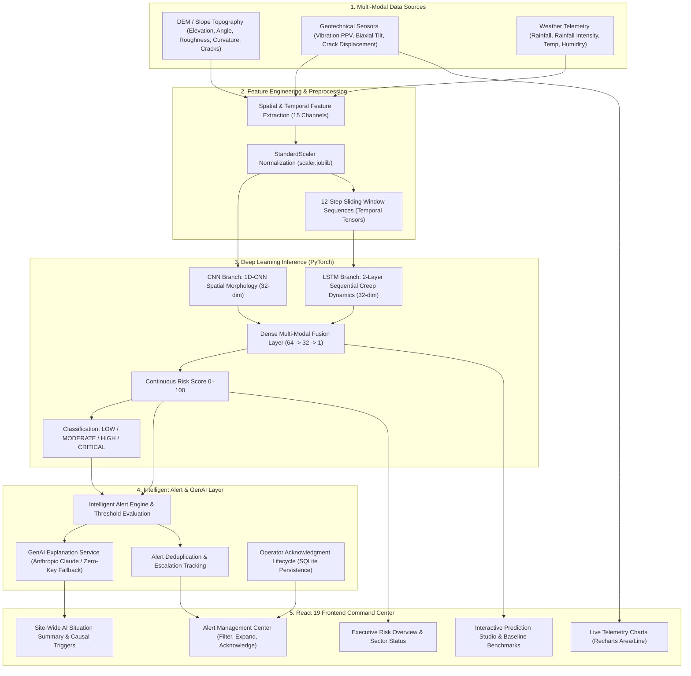

# AI-Based Multi-Modal Rockfall Risk Prediction and Early Warning System

> **PROTOTYPE & DEMO DISCLAIMER:**  
> This application is an academic / hackathon software prototype designed to evaluate multi-modal predictive modeling, explainable AI alerting architectures, and geotechnical telemetry visualization. It uses **synthetic and simulated demo data streams**. It is **NOT** connected to live mine sirens, government early warning infrastructure, or certified emergency dispatch centers. Real sensors, satellite InSAR feeds, and micro-seismic hardware are architected as modular interfaces for future deployment.

---

## 1. Project Overview

Open-pit mines, quarries, rail cuttings, and mountainous transit corridors face severe hazards from sudden rockfall detachments and catastrophic bench collapses. Traditional mine monitoring depends on isolated instruments (e.g., individual crack extensometers or periodic manual inspection), often resulting in delayed detection, false alarms, and lack of actionable situational context.

**RockfallAI** is an intelligent, multi-modal early warning software platform that:
- Ingests spatial morphology (DEM slope angle, elevation, roughness, curvature, fracture density).
- Ingests temporal sensor streams (vibration PPV, crack displacement, biaxial tilt, rainfall, temperature, pore-water pressure).
- Ingests live atmospheric conditions (rainfall precipitation rate, rainfall intensity, humidity).
- Uses a **CNN-LSTM Hybrid Deep Learning Model** to forecast a continuous 0–100 risk score and 4-tier risk classification.
- Employs an **Explainable GenAI Layer** (Anthropic Claude API with a deterministic zero-key fallback) to generate natural language causal reasoning and operational safety recommendations without altering model outputs.
- Features an **Intelligent Alert Engine** with threshold-based triggering, deduplication, and operator acknowledgement.
- Delivers an industrial-grade dark engineering dashboard built in React 19.

---

## 2. Problem Statement

Rockfall incidents in open-pit mining environments are sudden, non-linear phenomena driven by complex multi-physics couplings:
1. **Dynamic Dynamic Stress:** Blasting operations and heavy equipment haulage cause high-frequency vibration (Peak Particle Velocity) that breaks residual joint cohesion.
2. **Hydrogeological Saturation:** Torrential precipitation infiltrates rock discontinuities, inducing high cleft water pressures that drastically reduce effective shear resistance.
3. **Kinematic Creep:** Progressive joint dilation and rotational block tilting precede detachment, accelerating through primary, secondary, and tertiary creep stages.
4. **Data Fragmentation:** Mine safety operators are often inundated with raw numerical readings across disparate platforms without causal interpretation or unified risk indexing.

---

## 3. Proposed Solution

This project implements an end-to-end multi-modal data fusion and explainable AI architecture:
- **Unified Multi-Modal Pipeline:** Fuses spatial terrain metrics, temporal geotechnical time-series, and atmospheric conditions.
- **Deep Spatial-Temporal Modeling:** Combines a 1D-CNN branch (extracting spatial morphology) with a multi-layer LSTM branch (capturing sequential kinematic creep) fused through a dense multi-modal regression head.
- **Strict Separation of Concerns:** The CNN-LSTM model deterministically establishes the quantitative Risk Score (0–100) and Risk Level (LOW, MODERATE, HIGH, CRITICAL). The GenAI layer strictly explains the prediction and formulates operational recommendations without overriding mathematical predictions.
- **Intelligent Alert Lifecycle:** Automated alert creation with de-duplication, state tracking, and supervisor acknowledgement via REST API endpoints.
- **Zero-Key Deterministic Fallback:** 100% operational uptime guaranteed even when LLM API keys or internet connections are absent.

---

## 4. System Architecture



---

## 5. Data Sources

| Data Source | Type | Status in Prototype | Parameters Captured |
|---|---|---|---|
| **Digital Elevation Model (DEM)** | Spatial Morphology | DEMO / READY | Elevation (m), Slope Angle (°), Roughness Index, Curvature Index |
| **Geological Surveys / Drone Orthophotos** | Spatial Structural | DEMO / READY | Fracture / Crack Density (0–1), Lithological Classification |
| **Geotechnical Sensors** | Temporal Telemetry | SIMULATED STREAM | Vibration PPV (mm/s), Biaxial Tilt Deviation (°), Crack Displacement (mm) |
| **Atmospheric Weather** | Environmental | SYNTHETIC DEMO / OPENWEATHER | Rainfall Precipitation (mm/h), Rainfall Intensity, Ambient Temp (°C), Humidity (%) |
| **Pore-Water Pressure** | Hydrogeological | SIMULATED STREAM | Discontinuity cleft water pressure index (0.0–1.0) |

---

## 6. Synthetic Dataset

- **Dataset Size:** 2,000 synthetic observations across 4 distinct pit zones (`ZONE-A`, `ZONE-B`, `ZONE-C`, `ZONE-D`).
- **Sequence Length:** 12 sequential hourly time-steps per observation window.
- **Physical Realism:** Target risk calculation embeds empirical geotechnical physics:
  - 30% Weight: Structural kinematic crack opening rate (\(\text{displacement}^{1.35}\)).
  - 25% Weight: Hydrogeological pore-water pressure coupled with precipitation intensity.
  - 20% Weight: Peak Particle Velocity dynamic vibration from blasting or haulage.
  - 15% Weight: Slope morphology (gradient > 45°, fracture density, roughness).
  - 10% Weight: Biaxial rotational tilt divergence.
  - Secondary bonuses: Freeze-thaw thermal wedging (-2°C to +2°C with high humidity).
- **Dataset Storage:** Saved as `backend/data/synthetic/rockfall_dataset.csv`.

---

## 7. CNN-LSTM Architecture

The neural network (`RockfallCNNLSTM`) uses a dual-branch representation learning architecture:
1. **Spatial Branch (1D-CNN):**
   - Input: 6 spatial features (`elevation`, `slope_angle`, `terrain_roughness`, `curvature`, `drainage_index`, `crack_density`).
   - Layer: Conv1D (kernel_size=3, padding=1) \(\rightarrow\) BatchNorm1d \(\rightarrow\) ReLU \(\rightarrow\) Dropout(0.2) \(\rightarrow\) Linear projection to 32 dimensions.
2. **Temporal Branch (LSTM):**
   - Input: 12-step sequence of 5 sequential geotechnical channels (`vibration`, `tilt`, `displacement`, `rainfall`, `temperature`).
   - Layer: 2-layer stacked LSTM (hidden_size=32, batch_first=True, dropout=0.2) \(\rightarrow\) Final hidden state extraction (32 dimensions).
3. **Multi-Modal Fusion Head:**
   - Concatenation of Spatial (32) + Temporal (32) representations into a 64-dimensional feature vector.
   - Fully Connected Layers: Linear(64 \(\rightarrow\) 32) \(\rightarrow\) ReLU \(\rightarrow\) Dropout(0.2) \(\rightarrow\) Linear(32 \(\rightarrow\) 1) \(\rightarrow\) Sigmoid \(\times\) 100.
   - Target Output: Bounded scalar risk score \([0.0, 100.0]\).
- **Benchmark Baselines:** Validated against Scikit-Learn `RandomForestRegressor` (MAE: 2.32, Test Accuracy: 94.7%) and `XGBoost`.

---

## 8. Risk Classification

The continuous 0–100 risk score is categorized into 4 operational hazard tiers:

| Score Range | Risk Level | Meaning | Prototype Recommended Action |
|---|---|---|---|
| **0 – 24** | `LOW` | Slope operating at baseline stability equilibrium | Routine continuous monitoring. Standard PPE. Normal mining operations permitted. |
| **25 – 49** | `MODERATE` | Telemetry variances slightly above normal | Enhanced monitoring notification. Increase sampling frequency to 15-minute intervals. Deploy secondary drone inspection. |
| **50 – 74** | `HIGH` | Accelerated joint dilation and elevated moisture | Safety inspection recommended. Restrict heavy equipment and personnel within slope perimeter. |
| **75 – 100** | `CRITICAL` | Imminent detachment hazard; tertiary creep | Immediate safety assessment and access restriction should be considered according to established site safety procedures. |

---

## 9. GenAI Layer

The GenAI layer translates numerical ML predictions into professional engineering briefings for mine supervisors and safety personnel.

### LLM Provider Abstraction
- **Preferred Provider:** Anthropic Claude API (`claude-3-haiku-20240307` or `claude-3-5-sonnet-20241022`).
- **Key Security:** Configured exclusively in `backend/.env` via `ANTHROPIC_API_KEY=`. Never exposed to frontend clients.
- **Prompt Safety Guardrails:**
  - Strictly limited to provided input data; hallucinations of unmeasured sensors are forbidden.
  - Disclaims scientific validation and certainty; identifies output as an academic prototype evaluation.
  - Refrains from issuing government evacuation orders or legal commands.
- **Deterministic Zero-Key Fallback:**
  When `ANTHROPIC_API_KEY` is omitted or network calls fail, the system automatically engages `generate_fallback_explanation()`:
  - If rainfall \(\ge 12\) mm/h: *"High rainfall is contributing to the current risk assessment."*
  - If displacement \(\ge 3\) mm: *"Increased displacement is contributing to the current risk assessment."*
  - If vibration \(\ge 6\) mm/s: *"Elevated vibration is contributing to the current risk assessment."*
  - If slope \(\ge 50^\circ\): *"Steep terrain contributes to the current risk assessment."*
  - Displays `"AI Explanation: Demo Fallback"` in the UI.

---

## 10. Alert System

The Alert Engine (`backend/app/services/alert_service.py`) manages early warnings:
- **Source Categorization:** Alerts are tagged with origin: `"MODEL"`, `"GENAI"`, or `"SENSOR"`.
- **Intelligent De-duplication:**
  - Prevents alert flooding when telemetry refreshes at the same risk tier.
  - Creates a new alert when:
    1. Risk level increases (e.g. MODERATE \(\rightarrow\) HIGH \(\rightarrow\) CRITICAL).
    2. Risk crosses an operational threshold.
    3. Significant score shift occurs (\(\ge 15\) points deviation within the same level).
    4. A previously acknowledged alert is followed by a new elevated risk event.
    5. A recovery notice occurs when de-escalating from CRITICAL to HIGH.
- **Acknowledgement Workflow:**
  - `PATCH /api/alerts/{id}/acknowledge` marks the alert as acknowledged.
  - Decrements unacknowledged count in dashboard header while permanently preserving incident records in SQLite alert history.

---

## 11. Technology Stack

- **Backend:**
  - Python
  - FastAPI (Asynchronous Web Framework)
  - Uvicorn (ASGI Application Server)
  - SQLAlchemy 2.0 (Relational ORM)
  - SQLite (Local Embedded Database)
  - Pydantic v2 (Validation & Serialization)
  - PyTorch (CNN-LSTM Hybrid Model)
  - Scikit-learn & Joblib (StandardScaler Preprocessing)
  - HTTPX (Asynchronous HTTP Client for Claude & OpenWeather APIs)
- **Frontend:**
  - React 19
  - Vite 8 (Ultra-fast build tooling)
  - Recharts (Time-series geotechnical telemetry plotting)
  - Lucide React (Industrial instrumentation icons)
  - Native CSS Variables (Dark engineering dashboard UI)

---

## 12. API Endpoints

### System & Health
- `GET /health` — Operational uptime check and prototype disclaimer.
- `GET /api/system/status` — Live status of backend, database, CNN-LSTM, GenAI, weather, and demo mode.

### Predictions & Machine Learning
- `GET /api/zones` — List all 4 monitored pit zones.
- `GET /api/zones/{zone_id}` — Detailed geotechnical profile for a zone.
- `GET /api/predictions` — Chronological prediction history log.
- `POST /api/predictions/predict` — Execute multi-modal CNN-LSTM inference on custom feature inputs.
- `GET /api/predictions/model-status` — Return PyTorch architecture status, training samples, and test MAE.
- `GET /api/predictions/model-comparison` — Benchmark table comparing CNN-LSTM vs Random Forest.

### Explainable GenAI Intelligence & Weather
- `POST /api/ai/explain` — Produce natural language explanation, causal breakdown, and safety guidance for a zone.
- `POST /api/ai/site-summary` — Synthesize site-wide operational risk overview across all 4 zones.
- `GET /api/weather/current` — Current atmospheric reading (OpenWeatherMap API or synthetic demo fallback).

### Geotechnical Sensors & Simulation
- `GET /api/sensors` or `GET /api/sensors/current` — Latest telemetry for all monitored pit zones.
- `GET /api/sensors/history?zone_id=ZONE-A&limit=24` — 24-hour historical telemetry stream.
- `POST /api/sensors/tick` — Trigger synthetic telemetry update, re-run prediction, and evaluate alerts.
- `POST /api/sensors/scenario` — Inject operational demo scenario (`NORMAL`, `MODERATE`, `HIGH`, `CRITICAL`).

### Alerts & Early Warnings
- `GET /api/alerts` — Retrieve alerts with optional `zone_id` and `unread_only` filters.
- `POST /api/alerts/generate` — Dispatch manual demo alert for evaluation.
- `PATCH /api/alerts/{alert_id}/acknowledge` — Operator acknowledgement of active alert via URL parameter.
- `POST /api/alerts/{alert_id}/acknowledge` — Backward-compatible operator acknowledgement.
- `POST /api/alerts/acknowledge` — Operator acknowledgement via JSON payload (`{"alert_id": <id>}`).

---

## 13. Installation

### Prerequisites
- Python 3.10+ (tested with Python 3.11/3.14)
- Node.js 18+ and npm
- Git

### 1. Clone Codebase
```bash
git clone <repository_url>
cd "Individual Project"
```

### 2. Backend Dependencies
```bash
cd backend
pip install -r requirements.txt
```

### 3. Frontend Dependencies
```bash
cd ../frontend
npm install
```

---

## 14. Running Instructions

### Step 1: Start FastAPI Backend
```bash
cd backend
uvicorn app.main:app --host 0.0.0.0 --port 8000 --reload
```
*Backend runs on `http://localhost:8000`. Swagger API docs available at `http://localhost:8000/docs`.*

### Step 2: Start React Frontend
In a separate terminal:
```bash
cd frontend
npm run dev
```
*Frontend runs on `http://localhost:5173`.*

### Step 3: Run Full Test Suite
```bash
cd backend
python -m unittest discover -s tests -p "test_*.py"
```

---

## 15. Environment Variables

Create `backend/.env` based on `backend/.env.example`:

```ini
# Backend Configuration
PROJECT_NAME="AI-Based Multi-Modal Rockfall Risk Prediction and Early Warning System"
ENVIRONMENT=development
PORT=8000
HOST=0.0.0.0

# Database
DATABASE_URL=sqlite:///./data/rockfall_risk.db

# GenAI API Configuration (Anthropic Claude API preferred)
# If left empty, system automatically uses deterministic zero-key fallback
ANTHROPIC_API_KEY=
ANTHROPIC_MODEL=claude-3-haiku-20240307
GENAI_PROVIDER=fallback

# Weather API Configuration (Optional - uses synthetic demo weather if empty)
OPENWEATHER_API_KEY=

# CORS
CORS_ORIGINS=["http://localhost:5173", "http://127.0.0.1:5173", "http://localhost:3000"]
```

---

## 16. Demo Mode & Operational Scenarios

The platform includes 4 pre-configured operational demo scenarios accessible from the header dropdown or via `POST /api/sensors/scenario`:
1. **NORMAL CONDITIONS:** Low vibration (1.2–3.2 mm/s), low displacement (0.2–0.9 mm), minimal rainfall (0.0–1.5 mm/h). Produces **LOW** risk.
2. **MODERATE RAINFALL:** Mild rainfall (7.0–12.0 mm/h), moderate vibration (4.5–6.8 mm/s). Produces **MODERATE** risk.
3. **HIGH RAINFALL:** Sustained precipitation (22.0–32.0 mm/h), increased displacement (6.0–9.5 mm), elevated vibration. Produces **HIGH** risk and triggers safety inspection alerts.
4. **CRITICAL INSTABILITY:** Heavy downpour (36.0–48.0 mm/h), rapid crack displacement (12.5–18.5 mm), severe pore pressure (0.80–0.95), peak vibration (19.0–27.0 mm/s). Produces **CRITICAL** risk and triggers immediate restriction alerts.

---

## 17. Limitations

- **Synthetic Telemetry:** Telemetry data is generated from empirical geotechnical equations rather than active borehole extensometers or radar interferometry.
- **DEM Resolution:** DEM slope profiles are modeled using 6 structural morphological indicators rather than high-density 1m LiDAR point clouds.
- **Prototype Status:** Recommended actions are guidance templates and must not be used as automated life-safety shutoff commands in operating open-pit mines.
- **LLM Rate Limits:** If using external LLM providers during internet disruption, the system relies on the deterministic rule-based fallback engine.

---

## 18. Future Work

- **InSAR Satellite Pipeline:** Integration with Copernicus Sentinel-1 interferometric synthetic aperture radar (InSAR) rasters for sub-centimeter line-of-sight displacement tracking.
- **Physical Edge Computing:** Porting CNN-LSTM inference to on-site NVIDIA Jetson edge nodes located on solar-powered pit rim telemetry towers.
- **3D Digital Twin:** Upgrading the 2D sector map to a full Three.js / WebGL 3D pit highwall mesh with live heatmap draping.
- **Borehole Piezometer Telemetry:** Ingestion of automated vibrating-wire piezometer telemetry for continuous phreatic line modeling.
